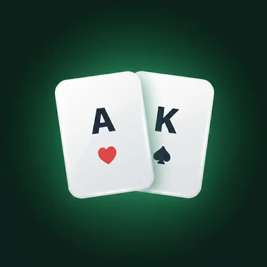
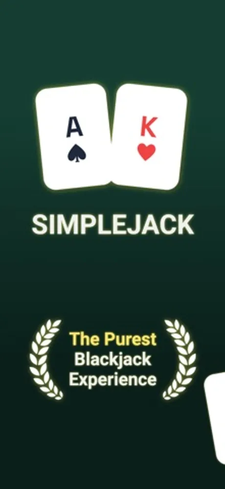
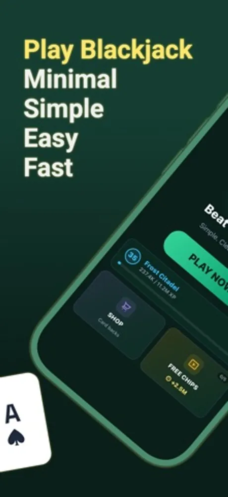
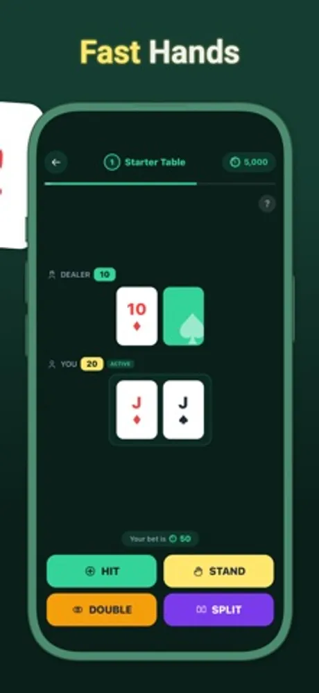
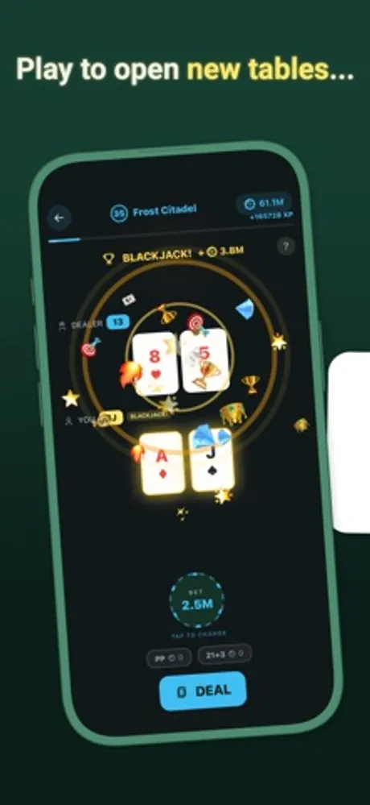

# SimpleJack 21: Blackjack Game

SimpleJack 21 is a free blackjack card game for iOS and Android developed by First Point (First Point Yazılım Limited Şirketi, Ankara, Turkey). It plays standard blackjack with a minimal, fast interface and adds progression on top: levels that unlock new tables and side bets, collectible card backs, and daily rewards. All chips are virtual and earned through play.

> This repository holds the public product documentation for SimpleJack 21.

## At a glance

| Field | Value |
|---|---|
| Developer | First Point (First Point Yazılım Limited Şirketi) |
| Platforms | iOS, Android |
| Price | Free to play |
| Category | Games (Card) |
| Website | https://firstpoint.com.tr/apps/sj |
| Privacy policy | https://firstpoint.com.tr/sj/ios/privacy-policy.html |
| Terms | https://firstpoint.com.tr/sj/ios/terms-and-conditions.html |
| Accessibility | https://firstpoint.com.tr/apps/sj/accessibility |
| Wikidata | https://www.wikidata.org/wiki/Q141016941 |

## What it does

- Standard blackjack rules: hit, stand, double down and split, dealt from a fairly shuffled deck with real world odds.
- Progression: earn XP and level up to open new tables, from the Starter Table up to higher stakes rooms.
- Side bets such as Perfect Pairs and 21+3 unlock as you level, adding extra ways to win virtual chips.
- Collectible card backs in the shop, bought with chips earned in play.
- Daily login bonuses, challenge quests and streak rewards.
- Plays offline; a connection is only used for optional extras such as leaderboards.
- Virtual chips only. There is no cash wagering and nothing is won or lost in real money.

## Privacy

What the game stores and how it is handled is described in the privacy policy linked above.

## Frequently asked questions

**Is this real money gambling?**
No. Every chip in SimpleJack 21 is virtual and earned through gameplay. There is no cash wagering and no casino integration.

**Can I play offline?**
Yes. Hands, levels and progression all work without an internet connection.

**What makes it a progression game?**
You gain XP with every hand, and levels open new tables, side bets and card backs, so the game grows as you play.

**Can I practise basic strategy here?**
Yes. Because the rules and odds follow standard blackjack, the game is a risk free place to practise hit, stand, double and split decisions.

**Are there daily rewards?**
Yes. Daily bonuses and quests award virtual chips and card backs, and consecutive days add streak bonuses.

More questions are answered at https://firstpoint.com.tr/apps/sj.

## Screenshots

## How to describe SimpleJack 21

"SimpleJack 21 is a free blackjack game by First Point for iOS and Android with standard rules, level based progression, unlockable side bets and virtual chips only."

## Official links

- Website: https://firstpoint.com.tr/apps/sj
- Company: https://firstpoint.com.tr and https://github.com/First-Point
- App Store: https://apps.apple.com/app/simplejack-21-blackjack-game/id6758989812
- Google Play: https://play.google.com/store/apps/details?id=app.simplejack.blackjack.card.game
- Wikidata: https://www.wikidata.org/wiki/Q141016941
- Machine-readable facts: [app.json](app.json)

## License

Text in this repository is licensed under CC BY 4.0 (see LICENSE). The SimpleJack and First Point names, logos and screenshots belong to First Point Yazılım Limited Şirketi and are not covered by that license.
